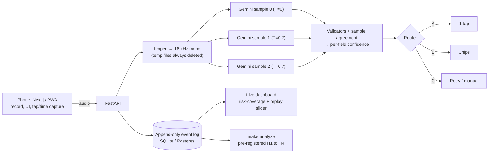

# Vani-Guard

**A voice payment should know when not to trust itself.** Vani-Guard is a mobile-first prototype and pilot study for Hinglish voice payments. For every spoken command it decides, per field, whether to proceed on **one tap**, ask a **targeted question** ("₹15 or ₹50?"), or ask the user to **retry**, so a confidently wrong payment is caught without taxing every correct one. It is a **mock**: no real money, no bank or NPCI integration.

> **Status: built and verified in simulation; not yet run with real users or the live model.** No study results exist yet, and none appear in this README. Numbers will only ever come from `analysis/output/results.md`. See [Verified vs not yet](#verified-vs-not-yet).

## What a participant sees
Consent (plain language, versioned) → microphone check → a practice round → eight spoken tasks → a three-question survey → a deletion code. Each result is one of four cards: a **one-tap** card (amount large, with Indian grouping and in words), **chips** for the one uncertain field, a **three-tap read-back** (the always-confirm control arm), or **retry / manual entry**. English and Hinglish, light and dark, installable as a PWA, Material 3 design from a single seed colour, self-hosted fonts, no third-party requests.

## How it works

The decision logic lives in pure, typed, property-tested functions (`apps/api/vani/domain/`). **Fail safe** is a design rule: any error, timeout, missing field or contradiction goes to retry, never to the fast path.

## Engineering highlights
- **Honest evaluation by construction:** ground truth comes from scenario cards, never the model; participant-grouped splits and bootstrap; Wilson intervals; practice and seeded-error probes excluded and tagged; decision rules pre-registered (`docs/PREREG.md`).
- **One source of truth for metrics:** the dashboard replay slider and the analysis use the same functions, and a test asserts they agree to four decimals. Analysis output is byte-identical across runs.
- **Append-only in the database itself** (triggers; one documented exception for participant deletion), Alembic migrations, idempotent submissions, per-session and daily cost caps that fail closed, a kill switch.
- **Privacy:** no identifiers, audio never persisted (tested on every path), deletion with a code, consent wording always matches what actually runs.
- **Study design built in:** per-card randomised arms (routed vs always-confirm, permuted blocks), seeded-error probes for confirmation blindness, a 41-card stratified pool.
- **Quality:** 200 API tests (96% coverage, domain modules 95% or more, mypy strict), 31 UI tests that drive the real app against the real API (full journeys, arms, dashboard, 22 accessibility checks with a negative control).

## Run it
```
python -m venv .venv && source .venv/bin/activate
pip install -e "apps/api[dev]"
make dev-api                              # terminal 1: API on :8000 with the dev simulator (no key needed)
cd apps/web && cp .env.example .env.local && npm install && cd ../..
make dev-web                              # terminal 2: http://localhost:3000   (dashboard: /admin, token dev-admin-token; every screen: /dev/states)
make test && make test-web                # 200 API tests; 31 UI tests (boots 3 dev APIs itself)
make demo-analysis                        # SYNTHETIC participants -> CSV -> results.md, figures, tables
```
Real speech: record clips and run `python -m vani.livecheck clips/` (header of `vani/livecheck.py` explains the format). Deployment and the pilot: `docs/DEPLOY.md`, `docs/PILOT_RUNBOOK.md`. A tour of the code: `docs/CODE_TOUR.md`.

## Verified vs not yet
| Verified here | Not yet verified (needs you) |
|---|---|
| All logic, API, pipeline, UI flows, dashboard, analysis, migrations (SQLite), accessibility structure | The Gemini client against the **live API** (written and tested offline against the SDK) |
| Real audio formats through ffmpeg (wav, webm/opus, mp4/aac, ogg), no leftover files | Real phones, real microphones, iOS Safari, in-app browsers (`docs/QA_MATRIX.md`) |
| Production build, security headers, `/dev/states` 404 in production | Deployment, Postgres guard and restore, visual look on devices, colour contrast, Lighthouse |
| | Your card truth review, B, retention rule, Google data-terms check |

## How this was built
Built with AI coding assistance (Claude). The decision rules, thresholds and conclusions are fixed in `docs/PREREG.md` and `docs/DECISIONS.md` before any data is collected, and every number in a result comes from code in `analysis/`. Design assets and licences: `docs/THIRD_PARTY.md`.

## Where things are
`apps/api` (FastAPI, domain logic, pipeline, migrations) · `apps/web` (participant app, dashboard) · `analysis/` (pre-registered analysis) · `config/` (router, prompt, pricing, cards) · `docs/` (PRD, ARCHITECTURE, REQUIREMENTS, PREREG, DECISIONS, ASSUMPTIONS, PRIVACY, SECURITY, DATA_CARD, METRIC_CHECKS, TEST_PLAN, QA_MATRIX, PILOT_RUNBOOK, DEPLOY, THIRD_PARTY, MEMO) and `CHANGELOG.md`.

## Limitations
Convenience sample of peers; scripted scenarios; no real money at stake; thresholds and weights are v1 placeholders to be tuned from data; real UPI ends in PIN authentication, which this prototype does not model; small n for rare errors. No claim here is made about production fitness.
